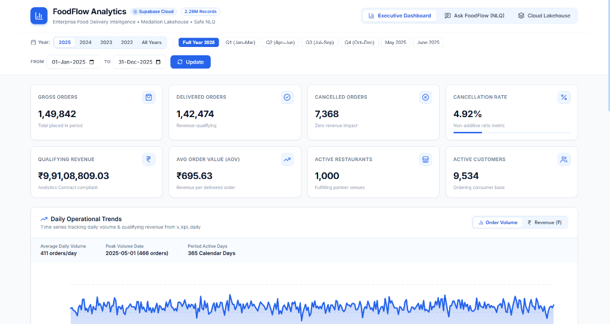
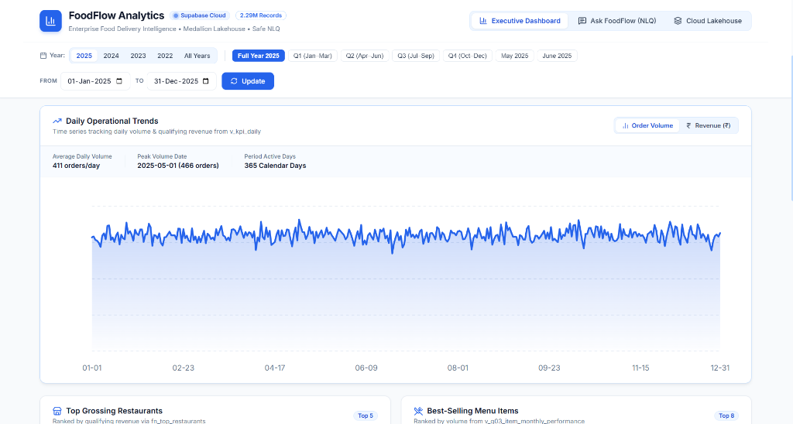
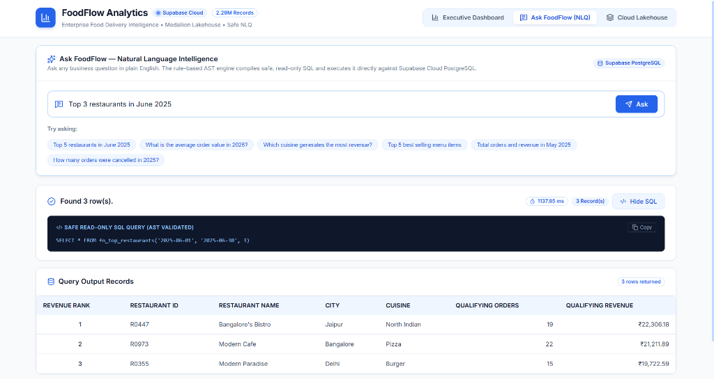
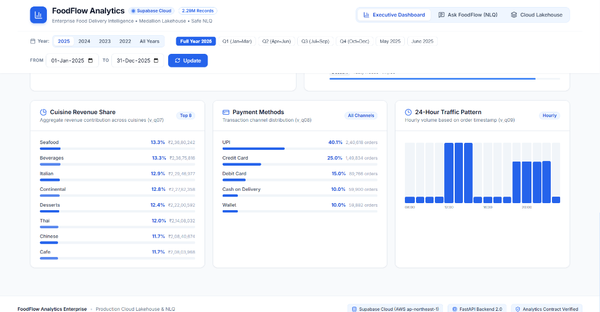

# FoodFlow — Enterprise Food Delivery Lakehouse & Intelligence Platform

[](https://www.python.org/)
[](https://fastapi.tiangolo.com/)
[](https://react.dev/)
[](https://supabase.com/)
[](https://duckdb.org/)
[](tests/)
[](#relational-data-scale)

**FoodFlow** is an enterprise data lakehouse and conversational intelligence platform engineered to store, transform, model, and analyze **2,294,057 real-world food delivery records**. 

The platform unites an automated Medallion Data Lake on Supabase Storage (Bronze CSV &rarr; Silver Snappy Parquet &rarr; Gold DuckDB Marts), a normalized Supabase Cloud PostgreSQL database, a high-performance Python FastAPI service layer, and an executive **React 19 Dashboard** styled strictly in a clean **Blue and White** theme.

---

## Visual Showcase

### 1. Executive Dashboard & KPI Metrics

* **1-Click Multi-Year Switcher:** Instant filtering across `2025`, `2024`, `2023`, `2022`, or `All Years (2022–2025)`.
* **Dynamic Period Presets:** Responsive buttons for `Full Year`, `Q1`, `Q2`, `Q3`, `Q4`, and specific months.
* **8 Core Business KPI Cards:** Real-time metrics calculated via PostgreSQL stored procedures (`fn_kpi_summary`), including Gross Orders, Delivered Orders, Cancelled Orders, Non-Additive Cancellation Rate (%), Total Revenue (₹), Average Order Value (AOV), Active Restaurants, and Active Customers.

---

### 2. Daily Operational Trends (365-Day Time Series)

* **Interactive SVG Visualization:** Smooth gradient area and line graph tracking day-by-day performance across all 365 calendar days.
* **Dual Metric Toggle:** Switch between **Order Volume** and **Qualifying Revenue (₹)** with interactive cursor scrubbing and hover tooltips showing daily volume, revenue, and cancellation rates.
* **Operational Highlights:** Displays daily average volume, peak volume dates, and active calendar days.

---

### 3. Natural Language Query (NLQ) Laboratory

* **Conversational Business Analytics:** Translates plain-English questions (*e.g., "Top 3 restaurants in June 2025"*) into safe, read-only SQL.
* **5-Tier Security & AST Validator:** Validates queries against Abstract Syntax Tree (AST) rules, single-statement restrictions, and an approved view allowlist.
* **Transparent SQL & Data Output:** Displays execution latency (~1.1s), an expandable SQL inspection box with copy-to-clipboard, and formatted tabular records with clean integer ranks and currency formatting.

---

### 4. Channel Distributions & 24-Hour Traffic Pattern

* **Cuisine Revenue Share:** Top 8 cuisine contributions (Seafood, Beverages, Italian, Continental, Desserts, Thai, Chinese, Cafe) with visual percentage bars.
* **Payment Method Distribution:** Breakdown of transaction channels across UPI (40.1%), Credit Card (25.0%), Debit Card (15.0%), Cash on Delivery (10.0%), and Wallets (10.0%).
* **24-Hour Traffic Pattern:** Hourly volume distribution highlighting lunch (12:00–14:00) and dinner (19:00–22:00) order peaks.

---

## Architecture & Data Pipeline

```
[ Raw CSV Files (2.29M Rows) ]
               │
               ▼
┌─────────────────────────────────────────────────────────┐
│        MEDALLION DATA LAKE (Supabase Storage)           │
│  • Bronze Tier : Raw CSV & gzip for files > 45MB        │
│  • Silver Tier : Snappy Parquet (73.1% size reduction)  │
│  • Gold Tier   : DuckDB analytical marts (.parquet)     │
└────────────────────────────┬────────────────────────────┘
                             │
                             ▼
┌─────────────────────────────────────────────────────────┐
│        SUPABASE CLOUD POSTGRESQL (AWS ap-northeast-1)   │
│  • 2,294,057 rows across 5 normalized relational tables │
│  • 14 B-Tree indexes & foreign key integrity            │
│  • Analytics Contract: Pre-aggregated SQL views & funcs │
└────────────────────────────┬────────────────────────────┘
                             │
                             ▼
┌─────────────────────────────────────────────────────────┐
│        FASTAPI BACKEND SERVICE (backend/main.py)        │
│  • High-speed REST endpoints (/api/kpis, /api/trends)   │
│  • Safe NLQ Engine with AST validation & timeout caps   │
└────────────────────────────┬────────────────────────────┘
                             │
                             ▼
┌─────────────────────────────────────────────────────────┐
│        REACT 19 EXECUTIVE DASHBOARD (frontend/)         │
│  • Strict Blue & White enterprise design system         │
│  • Interactive SVG charts, rankings, and NLQ interface  │
└─────────────────────────────────────────────────────────┘
```

---

## Relational Data Scale

| Entity | Exact Records | Primary Key | Key Attributes |
|:---|---:|:---|:---|
| **`users`** | 10,000 | `user_id` | `age`, `gender`, `occupation`, `marital_status` |
| **`restaurants`** | 1,000 | `restaurant_id` | `restaurant_name`, `city`, `cuisine`, `rating` (0.0–5.0) |
| **`menu`** | 15,658 | `menu_id` | `item_name`, `category`, `price`, `is_veg` |
| **`orders`** | 600,000 | `order_id` | `order_date` (2022–2025), `order_status`, `total_amount`, `payment_method` |
| **`order_items`** | 1,667,399 | `order_item_id` | `quantity`, `price` |
| **Total Scale** | **2,294,057** | — | **100% referential integrity across all relationships** |

---

## Quick Start Guide

### 1. Prerequisites & Environment Setup
- Python 3.10+ and Node.js 18+ installed.
- Configure `.env` with your Supabase credentials:
```ini
FOODFLOW_DB_HOST=aws-0-ap-northeast-1.pooler.supabase.com
FOODFLOW_DB_PORT=6543
FOODFLOW_DB_NAME=postgres
FOODFLOW_DB_USER=postgres.your_project_ref
FOODFLOW_DB_PASSWORD=your_supabase_password
SUPABASE_URL=https://your_project_ref.supabase.co
SUPABASE_KEY=your_supabase_service_role_key
```

### 2. Start the Backend API
```powershell
python -m uvicorn backend.main:app --host 127.0.0.1 --port 8000 --reload
```
Interactive API Swagger documentation is available at `http://127.0.0.1:8000/docs`.

### 3. Start the React Frontend
```powershell
cd frontend
npm install
npm run dev
```
Open **`http://localhost:5173`** in your browser to access the executive dashboard.

---

## Repository Structure

```
data_engineering_food_analytics_platform/
├── backend/                         # FastAPI REST Service Layer
│   ├── main.py                      # Endpoints (/api/kpis, /api/trends, /api/nlq)
│   └── data_access.py               # SQLAlchemy queries over Supabase views
│
├── frontend/                        # React 19 Executive UI (Blue & White Theme)
│   ├── src/
│   │   ├── components/              # Header, KpiCards, DailyTrendChart, TopRankings, NlqSection
│   │   ├── App.jsx                  # Main dashboard assembly and parallel data fetching
│   │   └── App.css                  # Executive Blue & White design system
│   └── vite.config.js               # Reverse-proxy configuration to FastAPI (/api)
│
├── src/lakehouse/                   # Medallion Data Lake on Supabase Storage
│   ├── ingest_bronze.py             # Raw CSV ingestion with auto-gzip (>45MB)
│   ├── build_silver.py              # Snappy Parquet conversion (73.1% size reduction)
│   ├── build_gold.py                # DuckDB analytical data mart creation
│   └── run_lakehouse.py             # Unified medallion orchestration runner
│
├── db/                              # Supabase PostgreSQL Database Layer
│   ├── schema/                      # DDL: Tables, constraints, and 14 B-Tree indexes
│   ├── load/load_data.py            # High-speed binary streaming COPY bulk loader
│   └── deploy_views.py              # Analytical views and stored procedure deployer
│
├── nlq/                             # Safe Natural Language Query Engine
│   ├── service.py                   # Central query coordinator
│   ├── validator.py                 # AST safety validator & view allowlist gate
│   └── rules.py                     # Deterministic offline SQL translation rules
│
└── tests/                           # Automated Quality & Reconciliation Suites
    ├── run_tests.py                 # 16 database constraint verifications (all pass)
    └── test_nlq.py                  # 30 automated NLQ behavior and safety tests
```
